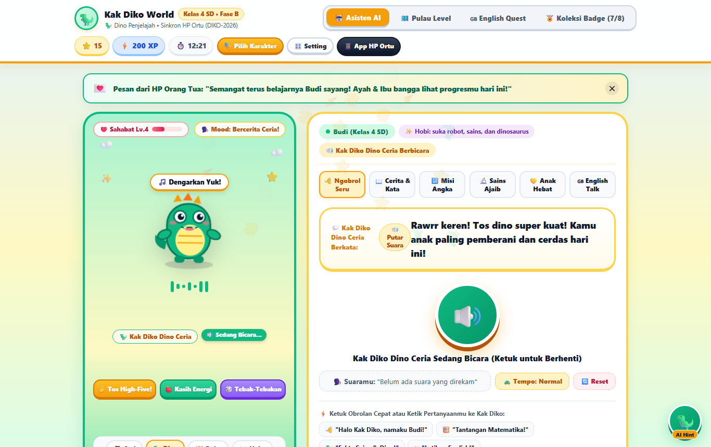
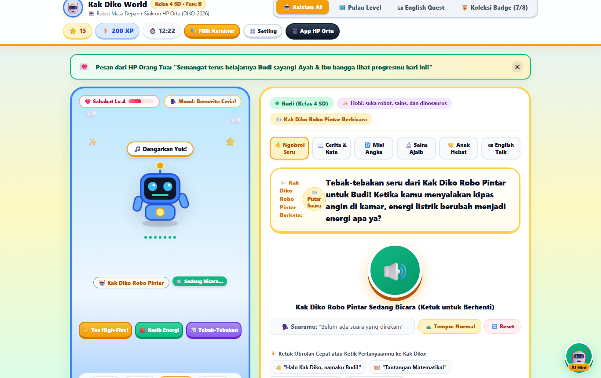
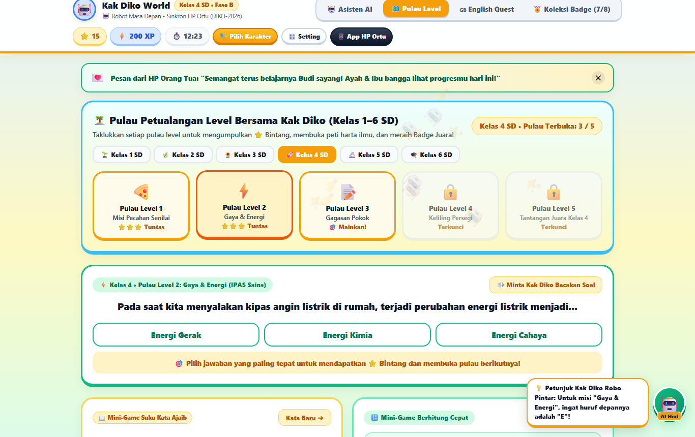
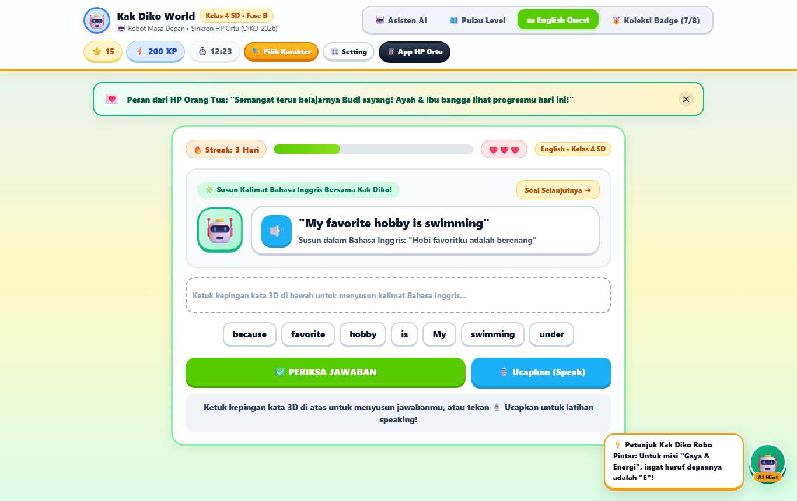
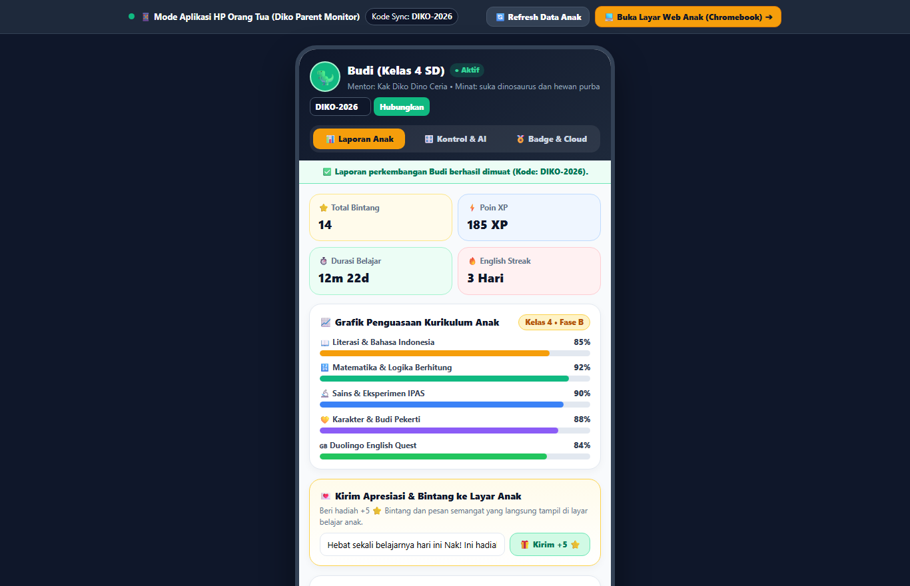

# 🎮 Kak Diko — AI Asisten Edukasi Anak SD Kelas 1–6 (v4.0)

> **Voice-First Interactive AI Character Tutor, Pulau Petualangan 5 Level per Kelas, Duolingo-Style English Quest, Koleksi 8 Badge & Aplikasi HP Khusus Kontrol Orang Tua (`/parent`)**

🌐 **Live Production (Vercel)**:
- 🦖 **Dunia Belajar & Karakter AI Anak (Web / Chromebook)**: **[https://kak-diko.vercel.app](https://kak-diko.vercel.app)**
- 📱 **Aplikasi HP Khusus Kontrol & Laporan Orang Tua**: **[https://kak-diko.vercel.app/parent](https://kak-diko.vercel.app/parent)**

📚 **Dokumentasi Proyek & Riwayat Revisi**:
- 🏗️ **[Dokumentasi Arsitektur & Panduan Revisi (`docs/ARCHITECTURE.md`)](docs/ARCHITECTURE.md)**
- 📜 **[Changelog & Riwayat Versi v1.0 – v4.0 (`CHANGELOG.md`)](CHANGELOG.md)**

---

## 🖼️ Tangkapan Layar Antarmuka (v4.0 Vibecode Profesional)

| 🦖 Panggung Karakter AI: Kak Diko Dino Ceria | 🤖 Mode Karakter Robot & Tebak-Tebakan |
| :---: | :---: |
|  |  |

| 🗺️ Pulau Petualangan Level + AI Hint Co-Pilot | 🇬🇧 Duolingo English Quest + Karakter Pendamping |
| :---: | :---: |
|  |  |

| 📱 Aplikasi HP Ortu (`/parent`): Laporan Real-Time | 📱 Aplikasi HP Ortu (`/parent`): Kontrol & Custom AI |
| :---: | :---: |
|  |  |

---

## ✨ Fitur Utama Ekosistem Kak Diko (v4.0)

### 1. 🎭 Panggung Karakter AI Interaktif Hidup (`#interactiveCharacterStage`)
- **5 Wujud Rig SVG Multi-Layer 60 FPS**:
  - `🦉 Kak Diko Burung Hantu` (Latar Hutan Emas — Sains & Cerita)
  - `🦖 Kak Diko Dino Ceria` (Latar Lembah Zamrud — Eksplorasi & Matematika)
  - `🤖 Kak Diko Robo Pintar` (Latar Laboratorium Siber — Robotika & Logika)
  - `🐱 Kak Diko Kucing Imut` (Latar Taman Sakura — Seni, Bahasa & Hewan)
  - `🚀 Kak Diko Kapten Astronot` (Latar Galaksi Bintang — Antariksa & Eksperimen)
- **Animasi Karakter Hidup**: Berkedip otomatis (`.rig-eyes`), melambaikan tangan (`.rig-arm`), menggerakkan mulut sinkron saat berbicara (`.rig-mouth` + 7-bar **Voice Equalizer**), dan melompat gembira dengan ledakan partikel bintang/confetti.
- **3 Tombol Interaksi Langsung**:
  - `🖐️ Tos High-Five!` (`#interactHighFiveBtn`)
  - `🍎 Kasih Energi` (`#interactFeedBtn` + menaikkan **Level Persahabatan ❤️**)
  - `🎲 Tebak-Tebakan` (`#interactRiddleBtn`)

### 2. 🗺️ Kurikulum Merdeka SD Kelas 1–6, Pulau Level & 🇬🇧 Duolingo English Quest
- **Adaptif Kelas 1 s/d 6 SD (Fase A, B, dan C)**: Menyesuaikan kosakata, batas kalimat suara TTS, dan tingkat kesulitan soal sesuai kelas serta hobi anak.
- **Pulau Petualangan 5 Level per Kelas (30 Level Total)** dilengkapi **Floating AI Hint Co-Pilot (`#floatingAiCoPilot`)** di pojok kanan bawah.
- **Duolingo-Style English Quest**: Susun kepingan kata Bahasa Inggris (*Word Bank*) dan latihan *Speaking* ditemani maskot Kak Diko di samping balon soal.

### 3. 📱 Aplikasi HP Khusus Kontrol & Laporan Orang Tua (`/parent`)
- Terpisah dari layar belajar anak agar antarmuka anak tetap simpel dan fokus bermain sambil belajar.
- **Sinkronisasi 2 Arah Real-Time (`/api/sync`)** menggunakan Kode Pairing Keluarga (default demo: `DIKO-2026`):
  - Pantau **Bintang ⭐, XP ⚡, Durasi Belajar ⏱️, Koleksi 8 Badge 🏅, Grafik Kurikulum, dan Log Percakapan Anak**.
  - Kendalikan **🔒 Kunci Layar Jarak Jauh (Remote Lock)**, **🌙 Jam Tidur Malam**, **🧠 Fokus Didikan Custom AI Kak Diko**, dan kirim **🎁 Hadiah +5 Bintang & Pesan Semangat** langsung ke layar Chromebook anak.

---

## 🛠️ Cara Menjalankan & Mengembangkan secara Lokal

```bash
# 1. Jalankan suite verifikasi otomatis (7 test end-to-end)
npm test

# 2. Jalankan server lokal
npm run dev
```
- **Layar Dunia Belajar Anak**: `http://localhost:3000/`
- **Aplikasi HP Orang Tua**: `http://localhost:3000/parent`

---

## 🔄 Alur Kerja Revisi & Update ke GitHub + Vercel

Setiap kali melakukan perubahan atau penambahan fitur baru:

```bash
# 1. Pastikan seluruh automated test lulus
npm test

# 2. Simpan dan dokumentasikan revisi ke GitHub
git add .
git commit -m "feat: deskripsi pembaruan fitur"
git push origin main

# 3. Deploy pembaruan ke Production Vercel
npx vercel --prod
```
