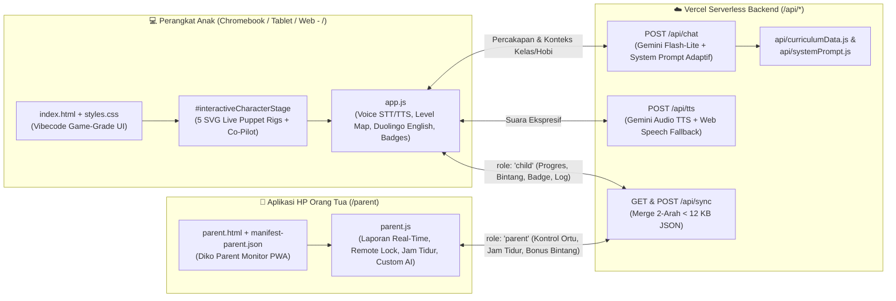

# 🏗️ Dokumentasi Arsitektur & Panduan Revisi — Kak Diko (AI Asisten Anak SD Kelas 1–6)

Dokumen ini menjadi pegangan teknis untuk melakukan **revisi, penambahan fitur, kustomisasi karakter, maupun pembaruan kurikulum** pada masa mendatang.

---

## 1. Diagram Arsitektur Ekosistem 2 Perangkat



---

## 2. Peta Struktur File & Tanggung Jawab Modul

| File / Folder | Peran & Tanggung Jawab Utama | Kapan Harus Diedit Saat Revisi? |
| :--- | :--- | :--- |
| [`index.html`](../index.html) | Antarmuka utama Dunia Belajar Anak (`/`), Panggung Karakter AI Interaktif, 4 Tab Petualangan, Modal Pilih Karakter/Kelas, dan Drawer Setting Simpel. | Saat menambah komponen layar baru, tombol baru, atau tab baru untuk anak. |
| [`styles.css`](../styles.css) | Desain visual *Vibecode Profesional* (3D tactile buttons, latar langit per karakter `body[data-scene]`, keyframe animasi SVG Puppet Rig `.rig-eyes`, `.rig-arm`, `.rig-mouth`). | Saat mengubah warna tema, ukuran tombol, atau menambah animasi karakter. |
| [`app.js`](../app.js) | Logika frontend aplikasi anak: SVG rig 5 karakter (`CHARACTER_SVG_ART`), interaksi karakter (Tos, Energi, Tebak-Tebakan), STT/TTS, Peta 5 Level per Kelas, Duolingo English Quest, dan sinkronisasi `/api/sync`. | Saat menambah soal kuis/level, kalimat Bahasa Inggris baru, atau interaksi karakter baru. |
| [`parent.html`](../parent.html) & [`parent.js`](../parent.js) | Aplikasi HP Khusus Orang Tua (`/parent`) dengan 3 tab: **📊 Laporan Anak**, **🎛️ Kontrol & AI**, dan **🏅 Badge & Cloud**. | Saat menambah fitur monitoring orang tua, grafik baru, atau pengaturan kontrol baru. |
| [`api/curriculumData.js`](../api/curriculumData.js) | Sumber kebenaran (*Source of Truth*) untuk 5 Karakter Kustom (`CHARACTER_COMPANIONS`), Profil Kurikulum SD Kelas 1–6 (`GRADE_PROFILES`), dan 8 Koleksi Badge (`ACHIEVEMENT_BADGES`). | Saat menambah karakter ke-6, mengubah fokus materi per kelas, atau menambah daftar badge baru. |
| [`api/systemPrompt.js`](../api/systemPrompt.js) | Merakit instruksi sistem AI (`buildSystemInstruction`), mengekstrak nama anak (`extractChildName`), sanitasi teks suara (`sanitizeForTTS`), dan respons fallback cerdas (`generateSmartFallbackReply`). | Saat menyempurnakan gaya bicara AI Kak Diko atau aturan pedagogis. |
| [`api/chat.js`](../api/chat.js) | Endpoint Serverless percakapan AI menggunakan `@google/genai` (`ai.interactions.create`). | Saat mengganti model Gemini atau menambah parameter API. |
| [`api/sync.js`](../api/sync.js) | Endpoint Serverless sinkronisasi 2 arah (`mergeFamilyPayload`) antara Web Anak dan Aplikasi HP Orang Tua via Kode Pairing (default demo: `DIKO-2026`). | Saat menghubungkan database eksternal (misal: Supabase / Upstash Redis / Google Drive). |
| [`tests/verify.test.mjs`](../tests/verify.test.mjs) | Suite pengujian otomatis end-to-end (7 pengujian mencakup kelengkapan file, sanitasi TTS, kurikulum Kelas 1–6, sinkronisasi 2 arah, dan rig karakter interaktif). | Wajib dijalankan (`npm test`) setiap selesai melakukan revisi kode. |

---

## 3. Panduan Cepat Melakukan Revisi di Masa Depan

### A. Cara Menambah atau Mengubah Soal Level & Duolingo English
1. Buka [`app.js`](../app.js).
2. Cari objek `GRADE_LEVEL_QUESTS` (untuk 5 pulau level per kelas 1–6 SD) atau `DUO_LESSONS_BY_GRADE` (untuk kalimat Duolingo English Quest per kelas).
3. Tambahkan atau ubah objek soal di kelas yang diinginkan.

### B. Cara Menambah Karakter Baru Kak Diko
1. Tambahkan metadata karakter baru di `CHARACTER_COMPANIONS` pada [`api/curriculumData.js`](../api/curriculumData.js) dan [`app.js`](../app.js).
2. Tambahkan gambar SVG beranimasi (dengan class `.rig-eyes`, `.rig-arm`, `.rig-mouth`) pada objek `CHARACTER_SVG_ART` di [`app.js`](../app.js).
3. Tambahkan warna latar panggung `body[data-scene="<id_karakter>"]` di [`styles.css`](../styles.css).

### C. Alur Kerja Git & Deploy Setiap Selesai Revisi
Setiap kali selesai mengedit kode di komputer:

```powershell
# 1. Pastikan seluruh pengujian otomatis lulus 100%
npm test

# 2. Simpan revisi ke riwayat Git & upload ke GitHub
git add .
git commit -m "feat: deskripsi singkat revisi yang dilakukan"
git push origin main

# 3. Update website produksi di Vercel
npx vercel --prod
```
